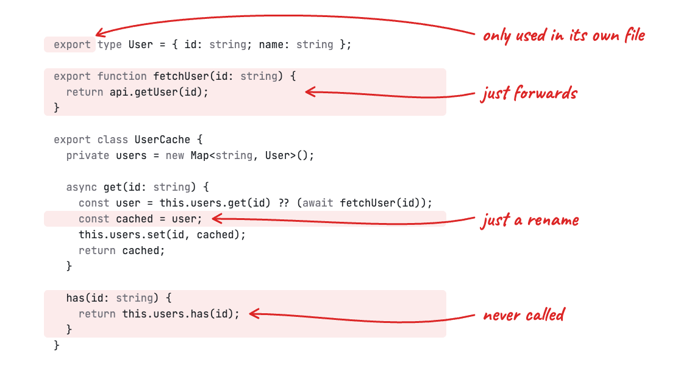

<h1 align="center">slop-police</h1>

<p align="center"><b>Stop LLM crimes in your codebase</b></p>

<p align="center">
  <picture>
    <source media="(prefers-color-scheme: dark)" srcset="assets/hero-dark.webp">
    
  </picture>
</p>

```sh
pnpm add -D slop-police
# or
npm i -D slop-police
```

Add a [`slop-police.json`](#configuration) and run `npx slop-police` (or `pnpm exec slop-police`).

## Instead of knip and jscpd

|                                            | slop-police | knip | jscpd |
| ------------------------------------------ | :---------: | :--: | :---: |
| Unused exports and files                   |      ✓      |  ✓   |       |
| Unused enum members                        |      ✓      |  ✓   |       |
| Unused class methods                       |      ✓      |      |       |
| Unused object keys                         |      ✓      |      |       |
| Copy-pasted code                           |      ✓      |      |   ✓   |
| Helpers rewritten instead of reused        |      ✓      |      |       |
| Pass-through wrappers, getters and aliases |      ✓      |      |       |
| Placeholder comments, flattened errors     |      ✓      |      |       |

## CI

Make CI fail when something slips through

```yaml
- run: npx slop-police
```

## Configuration

Put a `slop-police.json` in the directory you run it from:

```json
{
  "projects": ["packages/api/tsconfig.json", "packages/frontend/tsconfig.app.json"],
  "ignore": ["**/.next/**"],
  "testFiles": ["**/*.test.{ts,tsx}", "**/*.spec.{ts,tsx}"]
}
```

- `projects`: tsconfig files to analyze. Usages are counted across all of them, so a method used only by another package still counts as used.
- `ignore`: glob patterns (relative to the config) for files to skip entirely. Files that `.gitignore` ignores are skipped too.
- `testFiles`: glob patterns for tests. Usages inside tests count, but declarations inside tests are not reported.
- `rules`: you usually don't need it, since every built-in rule is already on as an error. It's for rule options, like the stricter `unused-exports` setup below, and for turning on plugin rules. A rule takes `"error"`, `"warn"`, `"off"` or `[severity, options]`.
- `plugins`: modules with [custom rules](#custom-rules), as paths relative to the config or package names.

Exit code is `1` when there are errors, `2` for an invalid config, `0` otherwise.

## Rules

### unused-methods

Class methods, getters and setters that are never referenced anywhere in the analyzed projects.

```ts
class Store {
  load() {}
  reset() {} // Method Store.reset is never used
}
new Store().load();
```

It knows the ways a method gets called without being named: it implements an interface member that's used, or one from a library (the library calls it), it's picked with `Pick<Class, "name">`, or an instance goes to a JSX prop whose type needs it. Private and protected members are skipped unless you turn on `includePrivate` or `includeProtected`.

### unused-object-keys

Keys of a top-level `const` object literal that are never read, as long as every use of the object reads statically known keys (`links.a`, `links["a"]`, `const { a } = links`). Objects that escape (passed to a function, spread, accessed dynamically) are skipped.

```ts
export const links = {
  docs: "https://example.com/docs",
  legacy: "https://example.com/old", // links.legacy is never read
};
open(links.docs);
```

### unused-exports

Agents love to `export` things just in case. This rule finds exports used only in their own file (just drop `export`) and exports nothing uses at all. Imports and re-exports count as uses, and so do uses in tests and ignored files. Files that nothing imports are entry points (`main.tsx`, a framework route, a config file), so their exports are left alone. A dynamic import (`import("./page")`) or a namespace used as a value (`Object.keys(ns)`) counts as using everything in the module.

```ts
// lib.ts, imported by main.ts as import { parse } from "./lib"
export type Options = { strict: boolean }; // Export Options is only used in its own file
export function parse(text: string, options?: Options) {}
export function format() {} // Export format is never used
```

If you want to be extra strict, list your entry points in the `entry` option. slop-police then also finds whole files that nothing imports from them or from tests. Code used only by such dead files counts as unused too.

```json
"unused-exports": ["error", { "entry": ["src/main.tsx", "src/routes/**/*.tsx", "vite.config.ts"] }]
```

### unused-enum-members

Enum members nothing uses. When the enum is used as a whole (`Object.values(Status)`, `keyof typeof Status`, passed to a function), any member could be in play, so the enum is skipped.

```ts
enum Status {
  Active,
  Archived, // Enum member Status.Archived is never used
}
const isActive = (status: Status) => status === Status.Active;
```

### no-identity-type-alias

A type alias that only renames another type.

```ts
type User = { id: string };
type Member = User; // Type alias Member only renames User
```

### no-pass-through-getter

A getter that only returns another property of `this`.

```ts
class Store {
  private items: Item[] = [];
  get list() { return this.items; } // Getter list only returns this.items
}
```

### no-pass-through-wrapper

A function or method whose body only returns a call (awaited or not) to a named function, passing its own parameters on as they are.

```ts
function loadUser(id: string) { // Function loadUser only forwards to api.loadUser
  return api.loadUser(id);
}
```

It uses types to skip wrappers that do something:

- the shape is required: a method of a typed object literal (a `Proxy` handler, a Worker's `fetch`), a method that implements or overrides an inherited member, or a function assigned to a variable with a declared type. An override that only calls `super`'s method of the same name is still reported.
- the wrapper adds types: type parameters, overloads, or parameter and return types declared differently from the callee's, like `t(key: TranslationKey)` around `translate(key: string)`.
- it delegates to a private or protected member, like `get(key) { return this.items.get(key); }`.

Calls on computed values (`getDay(date).getTime()`, `/^\s*$/.test(text)`) aren't forwarding, so they don't count.

### no-redundant-value-alias

A local `const` that only renames another `const`, when using the original directly means the same thing.

```ts
function render() {
  const user = getUser();
  const current = user; // Local alias current only renames user; use the original binding directly
  return current.name;
}
```

### no-single-string-cn

`cn()` called with a single static class string.

```tsx
<div className={cn("flex gap-2")} /> // Use the class string directly instead of wrapping it in cn()
```

### no-placeholder-comment

A comment that only promises future work instead of describing the code: "add more validation", "handle more cases", "can be extended in the future", "extend this logic", "customize this behavior", "future enhancement", "implement … here". Ordinary TODOs don't match.

```ts
function parse(input: string) {
  // Add more validation here
  return JSON.parse(input);
}
```

### no-duplicate-code

Copy-pasted code: at least 50 tokens in a row that repeat earlier code (in the same file or one before it by path) and span at least 11 lines. Tokens are compared by their text, types included, so a renamed variable or a different type ends a copy, but comments, formatting and imports are left out. Test files are neither reported nor compared. `// slop-police-ignore no-duplicate-code` above a statement, class member or object property takes it out of the comparison, so it is not reported as a copy or as the original. Options: `minLines` (default `11`, counting every line a copy spans) and `minTokens` (default `50`).

```ts
// update-card.ts and delete-card.ts both check the card the same way:
const userId = ctx.userId;
assert(userId);

const cards = await getCardsWithDeck(ctx.db, [input.id]);
if (cards.length === 0) {
  throw notFound("Card not found");
}
const card = cards[0];
if (card.deckAuthorId !== userId) {
  throw forbidden("You don't own this card");
}
// delete-card.ts:6:5  Lines 6-16 duplicate update-card.ts:6-16
```

### no-duplicate-function

A function whose body has the same shape as functions in at least two other files: a helper that was rewritten instead of reused. Shapes ignore the names of parameters and locals and the values of literals, but not the names of what the body calls or reads. Bodies with fewer than 2 statements or 16 syntax nodes, and functions in test files, don't count. Option: `minFiles` (default `3`, at least `2`), the number of files a shape has to appear in.

```ts
// users.ts, posts.ts and teams.ts each have:
export async function loadUsers(id: string) {
  const response = await fetchJson("/users/" + id);
  if (!response.ok) throw new Error("failed to load users");
  return response.data;
}
// Function loadUsers has the same body shape as loadPosts (posts.ts:1), loadTeams (teams.ts:1)
```

### no-stringified-unknown-error

`error instanceof Error ? error.message : String(error)` (in either order), which flattens a caught value into a string and drops its type, stack and cause. A plain `instanceof Error` check counts when the variable is named `error`, `err`, `e` or `cause`; an `||` of `instanceof` checks counts for any name. A function that does nothing but this conversion, like `getErrorMessage(error)`, is where it belongs and isn't reported; use it instead of repeating the expression.

```ts
try {
  await sendMessage(chatId, text);
} catch (error) {
  return { ok: false, error: error instanceof Error ? error.message : String(error) }; // Caught value error is flattened into a string
}
```

## Custom rules

Write rules in TypeScript or JavaScript, list their modules in `plugins` and turn them on in `rules`:

```json
{
  "projects": ["tsconfig.json"],
  "plugins": ["./slop-rules.ts"],
  "rules": {
    "no-direct-fetch": ["error", { "allowIn": "src/api/" }],
    "no-needless-nullish-fallback": "warn"
  }
}
```

A plugin exports rules made with `defineRule`, by default or by name. `visit` has a handler per node kind, called for every node of that kind in every linted file:

```ts
// slop-rules.ts
import { defineRule, isIdentifier, SyntaxKind } from "slop-police";

export const noDirectFetch = defineRule({
  name: "no-direct-fetch",
  // Option defaults. The config's options must have the same types.
  options: { allowIn: "" },
  visit: {
    CallExpression(node, ctx) {
      if (ctx.options.allowIn && ctx.file.path.startsWith(ctx.options.allowIn)) return;
      if (isIdentifier(node.expression) && node.expression.text === "fetch") {
        ctx.report(node.expression, "Use the API client instead of fetch()");
      }
    },
  },
});

export const noNeedlessNullishFallback = defineRule({
  name: "no-needless-nullish-fallback",
  visit: {
    BinaryExpression(node, ctx) {
      if (node.operatorToken.kind !== SyntaxKind.QuestionQuestionToken) return;
      const { checker } = ctx;
      const type = checker.getTypeAtLocation(node.left);
      if (!type) return;
      const nullable = [checker.getUndefinedType(), checker.getNullType()].some((t) => checker.isTypeAssignableTo(t, type));
      if (!nullable) ctx.report(node.right, `${node.left.getText()} is never null or undefined`);
    },
  },
});
```

Nodes, `SyntaxKind`, the `is*` guards and the checker come from the TypeScript 7 API that slop-police runs on. The handler's `ctx` has:

- `options`: the defaults merged with the config's options.
- `file`: the file being visited: `path` (relative to the config), `fileName`, `isTest` and `sourceFile`.
- `checker` and `program`: those of the file's project. Each checker call is a round trip to the linter process, so check the syntax first.
- `report(node, message)`: reports a finding at the node's start. `// slop-police-ignore` comments work as for built-in rules.

For rules that compare files, `create(ctx)` returns the visitor instead, so its state lives in a closure, and `finish` runs after the last file:

```ts
import { defineRule, type Node } from "slop-police";

export const noRepeatedUrl = defineRule({
  name: "no-repeated-url",
  create(ctx) {
    const byUrl = new Map<string, Node[]>();
    return {
      StringLiteral(node) {
        if (node.text.startsWith("https://")) byUrl.set(node.text, [...(byUrl.get(node.text) ?? []), node]);
      },
      finish() {
        for (const [url, nodes] of byUrl) {
          if (nodes.length > 2) for (const node of nodes) ctx.report(node, `${url} is hard-coded in ${nodes.length} places`);
        }
      },
    };
  },
});
```

Test rules with `lint` from `slop-police/testing`, which runs a rule alone on a source string (as `index.ts`) or on files (an object of paths to contents) in a strict TypeScript project:

```ts
import { lint } from "slop-police/testing";
import { noDirectFetch } from "./slop-rules.ts";

test("no-direct-fetch", () => {
  expect(lint(noDirectFetch, `fetch("/users");`)).toEqual([
    { file: "index.ts", line: 1, column: 1, message: "Use the API client instead of fetch()" },
  ]);
});
```

Plugins need the npm launcher (`npx slop-police` or `pnpm exec slop-police`), which runs them in Node while the linter serves ASTs and types. Published plugin packages must ship JavaScript, since Node doesn't run TypeScript from `node_modules`.

## Ignoring findings

A `// slop-police-ignore` comment directly above a statement, class member or object property silences findings in it, including everything nested inside. List rule names to silence only those, and add a reason after `--`:

```ts
class Store {
  // slop-police-ignore unused-methods -- called from the devtools console
  debug() {}
}

// slop-police-ignore
export const legacyLinks = { a: "/a", b: "/b" };
```

For `no-placeholder-comment`, put the ignore comment on the line directly above the reported comment.

## Requirements

macOS or Linux on arm64 or x64 (on Windows, use WSL), and Node.js 22.18 or later. The linter bundles its own TypeScript 7 compiler, so your tsconfigs need to work with TypeScript 7.

## License

MIT
